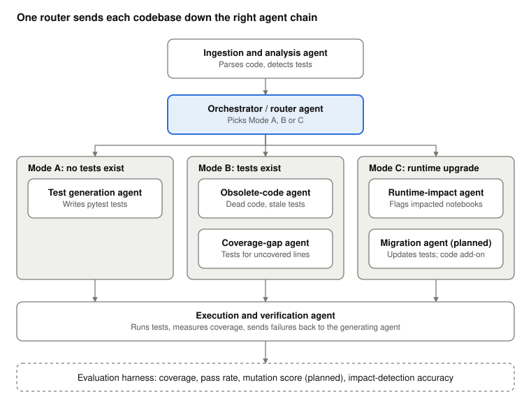

# Architecture

## Agents
| Agent | Responsibility | Uses an LLM? |
| --- | --- | --- |
| Ingestion and analysis | Scans a project, parses `.py`, `.ipynb` and Databricks-format notebooks, extracts functions, references and test imports | No |
| Orchestrator / router | Chooses Mode A, B or C, coordinates the others, writes reports and the run trace | No |
| Test generation | Plans which functions are testable, infers input schemas, retrieves guidance, writes tests | Optional |
| Execution and verification | Syntax-checks tests, runs pytest with coverage, parses results, triggers repair | No |
| Obsolete-code | Dead functions (no references in non-test code), stale test imports; writes cleaned copies | No |
| Coverage-gap | Functions without tests; functions with uncovered lines when coverage data exists | No |
| Runtime-impact | Matches code against runtime rules for the chosen DBR range; lists impacted notebooks, modules and tests | No (rules); planned for migration |

The baseline puts the LLM only where judgement and language matter (test bodies, repairs, later migration). Everything that can be decided exactly is decided by code, which keeps runs reproducible and makes the LLM's output checkable.

## Flow
1. **Ingest:** build a `ProjectIndex` (functions, notebooks, tests, references).
2. **Route:** no tests means Mode A; tests means Mode B; a requested upgrade adds Mode C.
3. **Mode A:** plan, generate, static check, run, repair (up to `max_repair_attempts`), report.
4. **Mode B:** find obsolete code, run existing tests for a baseline, find gaps (excluding dead code and entry points), generate tests for the gaps, run everything, compare coverage.
5. **Mode C:** apply the rules whose version window falls inside the upgrade, report findings, impacted notebooks and tests to review.

## Knowledge and retrieval
`knowledge/testing_guidelines.md` (how to test PySpark) and `knowledge/dbr_rules.json` (runtime changes) are chunked and indexed with TF-IDF (`src/ptagent/kb.py`). For each function the generator retrieves the two most relevant chunks and places them in the prompt; the runtime-impact agent retrieves test guidance for each matched rule.

## Notebook handling
Notebook cells cannot be imported, so reusable functions are extracted into `outputs/<project>/extracted/nb_<name>.py` and tests import from there. Magics (`%sql`, `%run`, `!cmd`) are neutralised so cells parse as Python.
